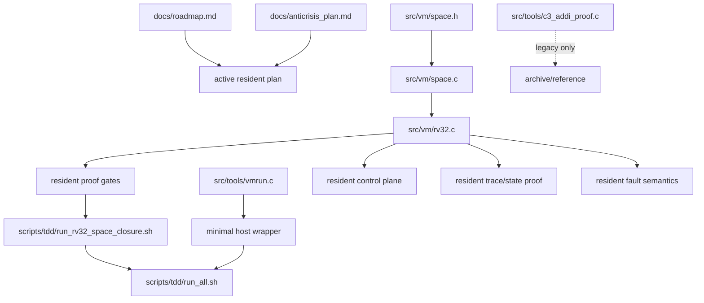

# Copy-Space Project Structure

This document describes the current stable construction of the project: what is active, what is legacy, and how the parts relate.

## Current State

The project is now organized around one active resident execution core:

- `src/vm/space.c` is the source of truth for resident `RV32I` execution.
- `src/vm/space.h` defines the resident state, stop reasons, trace records, and the VM object layout.
- `src/vm/rv32.c` and `src/vm/rv32.h` hold the resident execution core and trace helpers as a separate source boundary.
- `src/tools/vmrun.c` is a minimal host wrapper.
- `scripts/tdd/*` contains the active proof gates.
- `doc/roadmap.md` contains only action stages toward the goal.
- `doc/anticrisis_plan.md` contains the crisis-mode execution policy.
- `doc/legacy_inventory.md` freezes everything intentionally outside the active path.
- `doc/resident_orchestration_boundary.md` defines the scope of the `9.4` migration step.
- `doc/resident_orchestration_migration_plan.md` defines the execution plan for `9.4`.
- `doc/resident_job_descriptor.md` defines the first resident orchestration payload contract.
- `doc/resident_job_selection.md` defines the first resident orchestration selection contract.
- `doc/resident_tool_invocation.md` defines the first resident tool invocation contract.
- `doc/resident_toolchain_control.md` defines the first resident toolchain control contract.
- `doc/host_orchestration_freeze.md` freezes host orchestration as bootstrap-only.
- `doc/resident_boundary_final.md` freezes the final resident-oriented boundary.
- `doc/resident_copicode_runtime_boundary.md` defines the runtime boundary for `10.1`.
- `doc/resident_copicode_migration_plan.md` defines the execution plan for `10.2`.
- `doc/resident_copicode_artifact.md` defines the first resident copicode artifact contract.
- `doc/resident_copicode_handoff.md` defines the handoff contract for `10.3.2`.

`C3_RUN` exists only as a legacy artifact. It is not part of the active proof path.

## Layer Roles

### 1. Resident Core

`src/vm/space.c`:

- Implements the address-space emulator shell and channel/MMIO dispatcher.
- Calls into `src/vm/rv32.c` for resident `RV32I` execution.
- Keeps host-visible state transitions stable.

`src/vm/space.h`:

- Defines the VM object.
- Defines guest-state addresses and stop reasons.
- Defines trace record and trace info layouts.
- Defines the MMIO/channel layout.

`src/vm/rv32.c`:

- Implements resident `RV32I` execution.
- Owns guest load, step, stop, trace emission, and control-plane behavior.
- Owns the resident `trace/state` proof path.
- Owns the resident `request/response` control plane.

### 2. Host Wrapper

`src/tools/vmrun.c`:

- Loads an image into `vm->space`.
- Runs the VM for a bounded number of ticks.
- Optionally dumps the final space image.
- Optionally emits copy-trace diagnostics.

It does not implement guest semantics.
It does not interpret `RISC-V`.
It is a thin execution shell around `space.c`.

### 3. Resident Proof Gates

`src/tools/rv32_space_fault_proof.c`:

- Proves resident alignment and bounds fault behavior.

`src/tools/rv32_space_trace_proof.c`:

- Proves resident trace emission.
- Proves trace extraction through the resident ABI.
- Proves trace/state consistency.

`src/tools/rv32_space_control_proof.c`:

- Proves the resident request/response control plane.
- Verifies the minimal handshake and roundtrip behavior.

`src/tools/c3_addi_proof.c`:

- Legacy artifact.
- Kept for archival/reference purposes only.
- Not part of the active proof path.

### 4. Active Test Orchestration

`scripts/tdd/run_rv32_space_closure.sh`:

- Runs the resident closure gates only.

`scripts/tdd/run_all.sh`:

- Runs the active baseline and host-contract gates.
- Serves as the current minimal verification entrypoint.

### 5. Documentation

`doc/roadmap.md`:

- Contains only staged actions toward the project goal.
- No audit content.
- No diagnostic content.

`doc/anticrisis_plan.md`:

- Defines the crisis-mode operating policy.
- Defines the single active path and kill criteria.

`doc/space_minimal_host_contract.md`:

- Defines the minimal host wrapper contract.
- Draws the boundary between host responsibilities and resident semantics.

`doc/legacy_inventory.md`:

- Lists frozen legacy material.
- States the rule for what is and is not active.

`doc/resident_orchestration_boundary.md`:

- Defines what belongs to resident orchestration.
- Defines what is intentionally out of scope.

`doc/resident_orchestration_migration_plan.md`:

- Defines the execution steps for stage `9.4`.
- Keeps host bootstrap, resident orchestration, and toolchain migration separated.

`doc/resident_job_descriptor.md`:

- Defines the first resident orchestration payload.
- Serves as the contract for stage `9.4.5`.

`doc/resident_job_selection.md`:

- Defines the first resident orchestration selection rule.
- Serves as the contract for stage `9.4.6`.

`doc/resident_tool_invocation.md`:

- Defines the first resident tool invocation record.
- Serves as the contract for stage `9.4.7`.

`doc/resident_toolchain_control.md`:

- Defines the first resident toolchain control record.
- Serves as the contract for stage `9.4.9`.

`doc/host_orchestration_freeze.md`:

- Freezes host orchestration as bootstrap-only.
- States what is no longer active.

`doc/resident_boundary_final.md`:

- Freezes the final resident-oriented boundary.
- States what belongs in `space.*`, host, and resident boundaries.

`doc/resident_copicode_runtime_boundary.md`:

- Defines the runtime boundary for stage `10.1`.
- Describes resident runtime entrypoints, state, interfaces, and verification hooks.

`doc/resident_copicode_migration_plan.md`:

- Defines the execution plan for stage `10.2`.
- Describes how orchestration and toolchain control will move into resident copicode.

`doc/resident_copicode_artifact.md`:

- Defines the first resident copicode artifact format.
- Serves as the contract for stage `10.3.1`.

`doc/resident_copicode_handoff.md`:

- Defines the resident copicode handoff record.
- Serves as the contract for stage `10.3.2`.

## Diagram

## What Is Active

- Resident execution in `space.c`
- Resident trace/state proof
- Resident fault semantics
- Resident request/response control plane
- Minimal host wrapper
- Active proof gates in `scripts/tdd`

## What Is Legacy

- `C3_RUN` as a runtime path
- `c3_addi_proof` as an active proof mechanism
- Any scaffold-only or synthetic-trace-based path
- Any host-side guest semantics beyond the minimal wrapper contract
